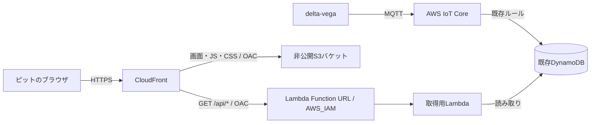

# delta-deneb

delta-vegaがMQTTでAWSに送信した走行データを、ピットのメンバーがブラウザで確認するシステム。
ログイン操作なしで共有URLから開き、走行中のデータと結果を自動更新する。

2026-10-12時点の初期設計。CDKの実装言語はPython。以下の追加構成は設計案であり、まだAWSにはデプロイしていない。

- リポジトリ: https://github.com/Siroyan/delta-deneb
- ローカル作業フォルダ: `/Users/siroyan/workspace/delta-deneb`

## 構成案

- S3に静的コンテンツを置き、CloudFrontからHTTPSで配信する。S3は通常のバケットオリジンを使い、パブリックアクセスをブロックする。
- CloudFrontの`/api/*`をLambda Function URLに振り分ける。画面とAPIを同一オリジンにし、ブラウザは相対URLでAPIを呼ぶ。
- S3とLambdaのオリジンにOAC（Origin Access Control）を使う。Lambda Function URLは`AWS_IAM`認証とし、指定CloudFrontディストリビューションからの呼び出しを許可する。
- ブラウザの利用者にはAWSログインを求めない。CloudFrontからLambdaへの認証と、利用者の閲覧制限は別に扱う。
- API応答は初期実装ではキャッシュしない。静的コンテンツは別のキャッシュ設定で配信する。
- まず数秒間隔のポーリングで更新する。暫定案は3秒間隔で、実際の送信頻度と必要な遅延を確認して決める。

## URL共有の扱い

認証なしのCloudFront URLは、公開エンドポイントである。URLを案内した人はログインせず閲覧でき、転送先の人も閲覧できる。
URLの非告知や検索除外だけでは、閲覧者を制限できない。

共有リンクを持つ人だけにデータを制限する必要がある場合は、推測困難な共有トークンをリンクに付け、API側で検証する方式を検討する。
その場合もリンク所有者へのアクセス許可であり、メンバー個人の認証にはならない。トークンの期限・失効・ログへの記録回避も一緒に設計する。
初期の閲覧方式は、この違いを踏まえて決定する。

## 既存DynamoDBとの接続

既存テーブルのARNを参照し、Lambdaに必要な読み取り権限を与える。最初の段階ではテーブルやIoTルールの所有権をCDKへ移さない。

最新データの取得方法は既存スキーマを確認して決める。

- 車両／走行単位のパーティションキーと時刻順のソートキーがある場合は、逆順の`Query`と`Limit=1`で最新の1件を取得できる。
- 最新状態を固定キーへ上書き保存している場合は、`GetItem`で取得する。
- 最新取得に適したキーがない場合は、GSIや最新状態用の保存先を検討する。その変更は別途設計する。
- テーブル全件の`Scan`を定期実行する方式は、通常の取得経路として採用しない。
- 時刻の型、単位、タイムゾーン、送信時刻と受信時刻の区別を確認する。GSIを使う場合は結果整合性による遅延も考慮する。

ブラウザから任意のテーブルやパーティションを指定できるAPIにはせず、対象の車両／走行と公開項目をサーバー側で制御する。

## 最初の実装範囲

1. テーブルのキー・保存データ例・表示対象を確認し、最新データの取得方法とAPI応答を決める。
2. Python CDKで、S3、CloudFront、Lambda、Function URL、OAC、IAM、CloudWatch Logsを定義する。
3. Lambdaに最新データ取得APIを実装する。データなし、取得失敗、更新停止を区別する。
4. 静的画面に必要な値、計測時刻、データの経過時間、通信状態を表示する。取得失敗時は最後のデータが古いことを示し、再試行する。
5. 最新取得・権限・オリジンの制限をテストし、`cdk synth`と`cdk diff`で構成を検証する。
6. 対象AWS環境へデプロイして実データで確認する。既存の受信・可視化構成を変更する必要がある場合は、差分を明示して扱う。

初回の受け入れ条件は、共有URLからログイン操作なしで画面を開けること、delta-vegaの新しいデータが所定の間隔で表示されること、更新が止まったときに古いデータだと判断できること。
更新間隔・停止判定の閾値・具体的な表示項目は未確定。

## 実装前に確認する情報

- AWSアカウント、リージョン、利用する認証プロファイル。
- 既存DynamoDBのテーブル名またはARN、パーティションキー／ソートキーの名前と型、必要に応じてGSI。
- 保存済みデータ1件の例と、対象車両／走行を識別する値。
- ピットで見たい項目、送信周期、必要な更新間隔、想定閲覧人数。
- URLを非告知で運用するか、共有トークンによるAPIの閲覧制限も必要か。

CDKはPythonで記述するが、CDK CLIの実行にはNode.jsも必要になる。依存関係と実行手順はCDK実装時に固定・記録する。

## AWS公式資料

- [CloudFrontからLambda Function URLへのアクセス制限](https://docs.aws.amazon.com/AmazonCloudFront/latest/DeveloperGuide/private-content-restricting-access-to-lambda.html)
- [CloudFrontからS3へのアクセス制限](https://docs.aws.amazon.com/AmazonCloudFront/latest/DeveloperGuide/private-content-restricting-access-to-s3.html)
- [AWS CDKのCloudFrontオリジンとOAC](https://docs.aws.amazon.com/cdk/api/v2/docs/aws-cdk-lib.aws_cloudfront_origins-readme.html)
- [DynamoDB Queryのソート順と取得上限](https://docs.aws.amazon.com/amazondynamodb/latest/APIReference/API_Query.html)
- [DynamoDB Scanの動作](https://docs.aws.amazon.com/amazondynamodb/latest/developerguide/Scan.html)
