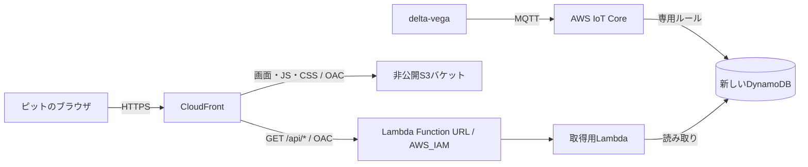

# delta-deneb

delta-vegaがMQTTでAWSに送信した走行データを、ピットのメンバーがブラウザで確認するシステム。
ログイン操作なしで共有URLから開き、走行中のデータと結果を自動更新する。

Step 1の配信基盤はユーザーの手元でデプロイ・確認済み。Step 2の新しいDynamoDBとIoTルール、共有トークンで保護した取得APIを実装済み。AWSへのデプロイ・実環境での確認は、引き続きユーザー自身が行う。Step 3の画面接続も実装済み。実機から画面までの確認は、delta-vegaを起動できるようになってから行う。

- リポジトリ: https://github.com/Siroyan/delta-deneb
- コンテナ内の作業フォルダ: `/workspaces/delta-deneb`

## AWS配信基盤（Step 1）

非公開S3、CloudFront標準URL、IAM認証のLambda Function URL、Pythonの`GET /api/health`、ログをCDKで定義している。Tokyo (`ap-northeast-1`) を使用し、アカウントID・認証情報をコードに固定しない。

セットアップからデプロイ、疎通確認までの手順は[Step 1のデプロイ手順](docs/step1-deployment.md)を参照。専用IAMユーザーのブラウザ認証でProfile `delta-deneb-login`に一時認証情報を取得し、AWS操作はユーザー自身がDev Container内で実行する。初回は[専用CDK配布基盤の準備](docs/bootstrap.md)を行う。既存の`CDKToolkit`を保持し、権限上限付きの専用基盤を管理者Profileで作成する設定とアプリ側の対応を実装済み。認証情報はチャットやリポジトリへ渡さない。

## データ保存と取得API（Step 2）

[Step 2のデプロイ手順](docs/step2-deployment.md)に従い、管理者で専用配布基盤の権限を更新してから、専用ユーザーで同じアプリスタックを更新する。

- 新しい`delta-deneb-dev-telemetry`テーブルと専用IoTルールで、既存トピックのデータを保存する。AWS受信時刻とUUIDを追加し、機器の`timestamp_ms`と区別する。
- 最新値・時刻範囲の履歴・推定ラップ情報を、同一オリジンの`/api/telemetry/*`から取得する。全件Scanは使わず、GSIへのQueryと件数・期間の上限を設ける。
- 閲覧トークンはSecrets Managerで生成・保存し、APIは`X-Deneb-Token`ヘッダーを検証する。Step 3のUIは共有リンクのフラグメントからヘッダーへ渡す。
- 新しいテーブルとSecretは保持する。既存のIoTルールや保存先は変更せず、過去データの自動移行は行わない。

デプロイ後は、ユーザー自身のProfileで次を実行する。トークンは表示せず、メモリ内だけで使用する。

```sh
uv run --locked python scripts/check_telemetry.py --outputs cdk-outputs.dev.json --profile delta-deneb-login --require-data
```

## 開発環境

開発はDev Containerを推奨する。DockerとVS CodeのDev Containers拡張を用意し、このリポジトリを開いて「Dev Containers: Reopen in Container」を実行する。Python 3.13・Node.js 24・npm・uv・AWS CLI v2がコンテナ内に入り、依存関係も初回起動時に自動で同期される。ローカルへのNode.js・npm・uv・Pythonの追加インストールは不要。

詳しい操作は[Dev Containerの手順](docs/devcontainer.md)を参照。起動後はコンテナ内のターミナルで次を実行できる。

```sh
npm test
npm run test:infra
npm run synth:offline
npm run preview
```

テストとテンプレート生成はAWSに接続しない。Pythonの依存関係は引き続きuvで管理し、仮想環境の手動作成・有効化は不要。

コンテナを使わず開発する場合は、uv・Python 3.13・Node.js 22以降・npmを用意し、リポジトリ内で次を実行する。

```sh
uv sync --locked
npm ci
```

## 実データ画面とローカル確認（Step 3）

[Step 3のデプロイ手順](docs/step3-deployment.md)に、画面更新・共有リンク作成・実機なしでの確認方法をまとめた。通常の画面は実APIを使い、`#token=…`付きの共有リンクからログインなしで開く。トークンなし・APIエラー・データなしを模擬走行で埋めない。

- 最新値を3秒間隔で取得し、受信から10秒を超えると更新停止を表示する。通信断では最後の値を残して自動再試行する。
- 過去の期間を日本時間で最大2時間指定し、推定した走行候補の切り替え・ラップ分析・CSV保存ができる。
- 履歴はページ分割と差分更新、ラップ一覧は初回・周回変更時などに取得する。GPS欠測・部分取得・無効リンクを明示する。
- 送信停止を完走と扱わない。走行区切り・ラップ時間・進捗は、現行MQTT項目から算出した推定・参考値。

実機なしで本番と同じ画面取得処理を確認するには、次を起動する。AWSへの接続は不要。

```sh
npm run preview:api
```

Dev Containerの8081番を転送し、<http://127.0.0.1:8081/#token=local-preview>を開く。これは合成データを返すローカルHTTP APIで、`local-preview`はAWSとは無関係のダミー値。

## UIデモの起動

```sh
npm run preview
```

リポジトリのルートで実行し、ブラウザで <http://127.0.0.1:8080/?demo=1> を開く。Dev Containerでは8080番ポートをローカルに転送する。`web/`がS3に配置する静的コンテンツのルートで、ビルド・外部CDN・追加ライブラリは不要。ES ModulesとコースJSONを読み込むため、`file://`ではなくHTTP経由で開く。

- 現在速度、平均速度、周回、経過時間、GPS由来のコース図、速度グラフ、ラップ一覧、ラップ分析を表示。
- 3秒ごとに模擬APIから取得。走行中／更新停止／APIエラー／GPS欠測／データなし／ゴールを右上で切り替えられる。
- 速度グラフは1分／5分／全体を切り替えられ、CSVに模擬データを書き出せる。
- 参考目標38:30はUI確認用の仮値。大会制限や車載機の設定値ではない。距離とゴール予測は平均速度とコース長からの参考値。
- 左右の余白は12pxで画面幅を使い切り、600px以上では数値4項目を一列に表示する。左側は大きなコース表示、右側は速度グラフ・ラップタイム・走行進捗を縦に並べる。600px未満のスマートフォン幅では1列構成へ切り替わる。
- コース図は北を上にし、輪郭に合わせて余白を詰める。現在位置・ON/OFF地点も同じ座標変換で表示する。ラップ時間はラップパネル、距離・ゴール予測は進捗パネルに表示する。

### 走行戦略の読み込み

「戦略を読み込む」からdelta-vega schema 1のJSONを選択する。「サンプルを試す」ではdelta-vega同梱の`motegi_demo.json`を読み込める。このサンプルは表示確認用で、実戦略ではない。

現在のコースIDは`motegi_oval_2025_full_v2`。全7周のON/OFF地点、コースID、経路ID、重複項目、区間順序、距離範囲、4096バイト上限などを検証する。不適合なファイルを読み込んでも、直前の有効な戦略を保持する。

- コース図の橙色はエンジン使用予定区間、青色は惰性予定区間。コース図は現在の周回を表示する。
- 「詳細」で各周の距離タイムラインとON/OFF距離を確認できる。ここで選ぶ周回は、現在位置表示とは独立したプレビュー。
- 現在のGPSを周回の経路に投影し、次のON/OFF地点までの推定距離を表示する。GPSが欠測・コースから60 m超の場合は距離を表示しない。
- 速度グラフの薄い橙色の背景は、受信GPSと計画を照合した使用予定区間。実際のエンジン稼働を示さない。
- 読み込んだJSONはこのブラウザのlocalStorageに保存し、再読み込み時に復元する。「解除」で保存と重ね合わせを解除できる。車両やAWSにファイルを送信しない。
- 戦略JSONには目標速度・目標時間は含まれないため、画面の参考目標は変更しない。

仕様の参照元はdelta-vega-v2の`assets/strategy/README.md`と`lib/vega_core/src/domain/strategy.cpp`。同梱コースデータと戦略サンプルの由来は[静的UIの設計メモ](docs/ui-demo.md)を参照。

### データ取得の境界とテスト

`web/js/telemetry-api.js`が実API取得・認証・再試行・履歴管理の境界。通常の画面は同一オリジンの`/api/telemetry/*`に接続する。明示的に`?demo=1`を指定した場合だけ、`web/js/mock-api.js`で模擬する。

Node.jsで実API取得処理・模擬API・戦略パーサーのテストを実行できる。追加パッケージは不要。

```sh
node --test tests/*.test.js
```

`latest`内の項目はdelta-vegaのMQTTフィールドに合わせている。ただし`timestamp_ms`は車載機の時計であり、UNIX時刻として表示しない。受信時刻の表示には別の`received_at_ms`を使用する。`phase`、ラップ履歴、表示用位置などは取得処理で補う表示用情報。実データのラップ履歴は推定で、完走は確定しない。実APIの契約と現在のMQTT項目から確定できない情報は、[Step 2のAPI仕様](docs/step2-deployment.md#保存形式と取得api)に記載する。

## 構成

Step 2で新しい保存先と取得APIを追加し、Step 3で画面から接続する構成を実装している。



- S3に静的コンテンツを置き、CloudFrontからHTTPSで配信する。S3は通常のバケットオリジンを使い、パブリックアクセスをブロックする。
- CloudFrontの`/api/*`をLambda Function URLに振り分ける。画面とAPIを同一オリジンにし、ブラウザは相対URLでAPIを呼ぶ。
- S3とLambdaのオリジンにOAC（Origin Access Control）を使う。Lambda Function URLは`AWS_IAM`認証とし、指定CloudFrontディストリビューションからの呼び出しを許可する。
- ブラウザの利用者にはAWSログインを求めない。CloudFrontからLambdaへの認証と、利用者の閲覧制限は別に扱う。
- API応答は初期実装ではキャッシュしない。静的コンテンツは別のキャッシュ設定で配信する。
- 3秒間隔のポーリングで更新する。実際の送信頻度と必要な遅延に応じて調整する。

## URL共有の扱い

認証なしのCloudFront URLは、公開エンドポイントである。URLを案内した人はログインせず閲覧でき、転送先の人も閲覧できる。
URLの非告知や検索除外だけでは、閲覧者を制限できない。

実データAPIは推測困難な共有トークンで保護する。Step 2でAPI側の検証を実装し、Step 3で共有リンクのフラグメントからヘッダーへ渡している。リンク所有者へのアクセス許可であり、メンバー個人の認証にはならない。トークンの更新とキャッシュの扱いは[Step 2の手順](docs/step2-deployment.md#保持トークン更新費用)を参照。

## DynamoDBの保存と読み取り

Step 2では新規テーブルを作成する方針に変更した。主キーは車両IDとサンプルUUID、時刻順のGSIは車両IDとAWS受信時刻を使用する。最新値は逆順Query・Limit 1で取得し、履歴は範囲Queryとページ分割を使用する。GSIは結果整合性であり、受信直後は反映の遅延があり得る。

ブラウザから任意のテーブルや車両を指定することはできない。現在のMQTTには走行ID・完走イベントがないため、走行の区切りとラップ時間は観測できるカウンターから推定し、不明なラップ時間は`null`、完走確認は`false`として返す。

## 3段階の実装

| 段階 | 内容 | 完了条件 |
| --- | --- | --- |
| Step 1 | Python CDK、S3・CloudFront配信、Lambdaヘルスチェック | AWSのURLでデモ画面が開き、疎通とオリジンへの直接アクセス拒否を確認できる |
| Step 2 | 新しいDynamoDBとIoTルール、最新値・履歴・推定ラップ情報を取得するAPI | 実際の走行データをAPIから取得できる |
| Step 3 | UIと実APIの接続、通信断復帰、実運用の検証 | delta-vegaからピット画面まで一連の動作を確認できる |

Step 1はユーザーの手元で確認済み。`codex/step3-live-dashboard`はStep 1・Step 2を含む。Step 3の画面と模擬HTTP APIでの検証を実装済みで、実機を含む受け入れ確認は保留中。AWSへの配布基盤更新・diff・deployと実データの確認は、ユーザー自身がDev Container内で実行する。

初回の受け入れ条件は、共有URLからログイン操作なしで画面を開けること、delta-vegaの新しいデータが所定の間隔で表示されること、更新が止まったときに古いデータだと判断できること。
更新間隔は3秒、停止判定は受信から10秒超として実装済み。実運用の計測結果に合わせて調整する。

## 今後確認する情報

- MQTTに走行ID・状態・確定ラップや完走・取消イベントを追加するか。
- 実運用の送信周期・閲覧人数と、画面の更新間隔。
- テレメトリーの保存期間と、推定ではない正式な走行IDによる過去結果の選択。

AWSの認証設定は手元だけで管理する。CDKはPythonで記述し、CLIの実行にはNode.jsも使用する。Pythonの依存関係は`pyproject.toml`で定義し、`uv.lock`で固定する。Node.jsの依存関係は`package-lock.json`で固定する。

## AWS公式資料

- [CloudFrontからLambda Function URLへのアクセス制限](https://docs.aws.amazon.com/AmazonCloudFront/latest/DeveloperGuide/private-content-restricting-access-to-lambda.html)
- [CloudFrontからS3へのアクセス制限](https://docs.aws.amazon.com/AmazonCloudFront/latest/DeveloperGuide/private-content-restricting-access-to-s3.html)
- [AWS CDKのCloudFrontオリジンとOAC](https://docs.aws.amazon.com/cdk/api/v2/docs/aws-cdk-lib.aws_cloudfront_origins-readme.html)
- [DynamoDB Queryのソート順と取得上限](https://docs.aws.amazon.com/amazondynamodb/latest/APIReference/API_Query.html)
- [DynamoDB Scanの動作](https://docs.aws.amazon.com/amazondynamodb/latest/developerguide/Scan.html)
