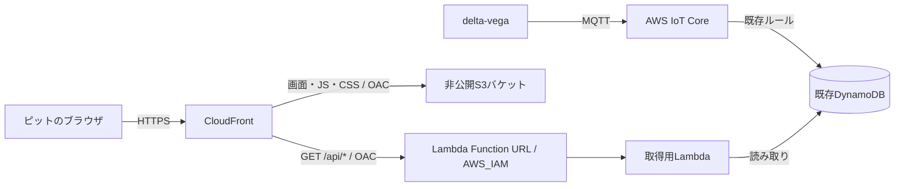

# delta-deneb

delta-vegaがMQTTでAWSに送信した走行データを、ピットのメンバーがブラウザで確認するシステム。
ログイン操作なしで共有URLから開き、走行中のデータと結果を自動更新する。

2026-10-17時点で、静的UI・模擬APIと、Python CDKによるStep 1の配信基盤を実装。AWSへのデプロイ・実環境での確認は、ユーザーの手元で行う。

- リポジトリ: https://github.com/Siroyan/delta-deneb
- コンテナ内の作業フォルダ: `/workspaces/delta-deneb`

## AWS配信基盤（Step 1）

非公開S3、CloudFront標準URL、IAM認証のLambda Function URL、Pythonの`GET /api/health`、ログをCDKで定義している。Tokyo (`ap-northeast-1`) を使用し、アカウントID・認証情報をコードに固定しない。

セットアップからデプロイ、疎通確認までの手順は[Step 1のデプロイ手順](docs/step1-deployment.md)を参照。専用IAMユーザーのブラウザ認証でProfile `delta-deneb-login`に一時認証情報を取得し、AWS操作はユーザー自身がDev Container内で実行する。初回は[専用CDK配布基盤の準備](docs/bootstrap.md)を行う。既存の`CDKToolkit`を保持し、権限上限付きの専用基盤を管理者Profileで作成する設定とアプリ側の対応を実装済み。認証情報はチャットやリポジトリへ渡さない。

開発はDev Containerを推奨する。DockerとVS CodeのDev Containers拡張を用意し、このリポジトリを開いて「Dev Containers: Reopen in Container」を実行する。Python 3.13・Node.js 24・npm・uv・AWS CLI v2がコンテナ内に入り、依存関係も初回起動時に自動で同期される。ローカルへのNode.js・npm・uv・Pythonの追加インストールは不要。

詳しい操作は[Dev Containerの手順](docs/devcontainer.md)を参照。起動後はコンテナ内のターミナルで次を実行できる。

```sh
npm test
npm run test:infra
npm run synth:offline
npm run preview
```

テストとテンプレート生成はAWSに接続しない。Pythonの依存関係は引き続きuvで管理し、仮想環境の手動作成・有効化は不要。

コンテナを使わず開発する場合は、uv・Python 3.13・Node.js 22以降・npmを用意し、リポジトリ内で次を実行する。

```sh
uv sync --locked
npm ci
```

## UIデモの起動

```sh
npm run preview
```

リポジトリのルートで実行し、ブラウザで <http://127.0.0.1:8080/> を開く。Dev Containerでは8080番ポートをローカルに転送する。`web/`がS3に配置する静的コンテンツのルートで、ビルド・外部CDN・追加ライブラリは不要。ES ModulesとコースJSONを読み込むため、`file://`ではなくHTTP経由で開く。

- 現在速度、平均速度、周回、経過時間、GPS由来のコース図、速度グラフ、ラップ一覧、ラップ分析を表示。
- 3秒ごとに模擬APIから取得。走行中／更新停止／APIエラー／GPS欠測／データなし／ゴールを右上で切り替えられる。
- 速度グラフは1分／5分／全体を切り替えられ、CSVに模擬データを書き出せる。
- デモ目標38:30はUI確認用の仮値。大会制限や車載機の設定値ではない。距離とゴール予測は平均速度とコース長からの参考値。
- 左右の余白は12pxで画面幅を使い切り、600px以上では数値4項目を一列に表示する。左側は大きなコース表示、右側は速度グラフ・ラップタイム・走行進捗を縦に並べる。600px未満のスマートフォン幅では1列構成へ切り替わる。
- コース図は北を上にし、輪郭に合わせて余白を詰める。現在位置・ON/OFF地点も同じ座標変換で表示する。ラップ時間はラップパネル、距離・ゴール予測は進捗パネルに表示する。

### 走行戦略の読み込み

「戦略を読み込む」からdelta-vega schema 1のJSONを選択する。「サンプルを試す」ではdelta-vega同梱の`motegi_demo.json`を読み込める。このサンプルは表示確認用で、実戦略ではない。

現在のコースIDは`motegi_oval_2025_full_v2`。全7周のON/OFF地点、コースID、経路ID、重複項目、区間順序、距離範囲、4096バイト上限などを検証する。不適合なファイルを読み込んでも、直前の有効な戦略を保持する。

- コース図の橙色はエンジン使用予定区間、青色は惰性予定区間。コース図は現在の周回を表示する。
- 「詳細」で各周の距離タイムラインとON/OFF距離を確認できる。ここで選ぶ周回は、現在位置表示とは独立したプレビュー。
- 現在のGPSを周回の経路に投影し、次のON/OFF地点までの推定距離を表示する。GPSが欠測・コースから60 m超の場合は距離を表示しない。
- 速度グラフの薄い橙色の背景は、受信GPSと計画を照合した使用予定区間。実際のエンジン稼働を示さない。
- 読み込んだJSONはこのブラウザのlocalStorageに保存し、再読み込み時に復元する。「解除」で保存と重ね合わせを解除できる。車両やAWSにファイルを送信しない。
- 戦略JSONには目標速度・目標時間は含まれないため、画面のデモ目標は変更しない。

仕様の参照元はdelta-vega-v2の`assets/strategy/README.md`と`lib/vega_core/src/domain/strategy.cpp`。同梱コースデータと戦略サンプルの由来は[静的UIの設計メモ](docs/ui-demo.md)を参照。

### データ取得の境界とテスト

`web/js/mock-api.js`の`getLatest()`が取得処理の境界。Step 3で、ここを同一オリジンのLambda APIへの`fetch()`に置き換える。Step 1でAWS上に配信した場合も、画面の走行データはブラウザ内で模擬する。

Node.jsで模擬APIと戦略パーサーのテストを実行できる。追加パッケージは不要。

```sh
node --test tests/*.test.js
```

`latest`内の項目はdelta-vegaのMQTTフィールドに合わせている。ただし`timestamp_ms`は車載機の時計であり、UNIX時刻として表示しない。受信時刻の表示には別の`received_at_ms`を使用する。`phase`、ラップ履歴、表示用位置などはデモ用の補助情報で、Lambdaの実応答形式はまだ確定していない。

## 構成案

以下は実データ接続まで含めた構成。Step 1では配信基盤とヘルスチェックを実装し、DynamoDBには接続しない。



- S3に静的コンテンツを置き、CloudFrontからHTTPSで配信する。S3は通常のバケットオリジンを使い、パブリックアクセスをブロックする。
- CloudFrontの`/api/*`をLambda Function URLに振り分ける。画面とAPIを同一オリジンにし、ブラウザは相対URLでAPIを呼ぶ。
- S3とLambdaのオリジンにOAC（Origin Access Control）を使う。Lambda Function URLは`AWS_IAM`認証とし、指定CloudFrontディストリビューションからの呼び出しを許可する。
- ブラウザの利用者にはAWSログインを求めない。CloudFrontからLambdaへの認証と、利用者の閲覧制限は別に扱う。
- API応答は初期実装ではキャッシュしない。静的コンテンツは別のキャッシュ設定で配信する。
- まず数秒間隔のポーリングで更新する。暫定案は3秒間隔で、実際の送信頻度と必要な遅延を確認して決める。

## URL共有の扱い

認証なしのCloudFront URLは、公開エンドポイントである。URLを案内した人はログインせず閲覧でき、転送先の人も閲覧できる。
URLの非告知や検索除外だけでは、閲覧者を制限できない。

共有リンクを持つ人だけにデータを制限する必要がある場合は、推測困難な共有トークンをリンクに付け、API側で検証する方式を検討する。
その場合もリンク所有者へのアクセス許可であり、メンバー個人の認証にはならない。トークンの期限・失効・ログへの記録回避も一緒に設計する。
初期の閲覧方式は、この違いを踏まえて決定する。

## 既存DynamoDBとの接続

既存テーブルのARNを参照し、Lambdaに必要な読み取り権限を与える。最初の段階ではテーブルやIoTルールの所有権をCDKへ移さない。

最新データの取得方法は既存スキーマを確認して決める。

- 車両／走行単位のパーティションキーと時刻順のソートキーがある場合は、逆順の`Query`と`Limit=1`で最新の1件を取得できる。
- 最新状態を固定キーへ上書き保存している場合は、`GetItem`で取得する。
- 最新取得に適したキーがない場合は、GSIや最新状態用の保存先を検討する。その変更は別途設計する。
- テーブル全件の`Scan`を定期実行する方式は、通常の取得経路として採用しない。
- 時刻の型、単位、タイムゾーン、送信時刻と受信時刻の区別を確認する。GSIを使う場合は結果整合性による遅延も考慮する。

ブラウザから任意のテーブルやパーティションを指定できるAPIにはせず、対象の車両／走行と公開項目をサーバー側で制御する。

## 3段階の実装

| 段階 | 内容 | 完了条件 |
| --- | --- | --- |
| Step 1 | Python CDK、S3・CloudFront配信、Lambdaヘルスチェック | AWSのURLでデモ画面が開き、疎通とオリジンへの直接アクセス拒否を確認できる |
| Step 2 | DynamoDBから最新値・履歴・ラップ情報を取得するAPI | 実際の走行データをAPIから取得できる |
| Step 3 | UIと実APIの接続、通信断復帰、実運用の検証 | delta-vegaからピット画面まで一連の動作を確認できる |

Step 1のコードと認証不要の検証を実装済み。AWSへのbootstrap・diff・deployはユーザー自身がDev Container内で実行し、公開URLはホスト側のブラウザで確認する。`main`から`dev`、`dev`から`codex/step1-aws-foundation`を作成し、Step 1の変更を実装ブランチに分けている。

初回の受け入れ条件は、共有URLからログイン操作なしで画面を開けること、delta-vegaの新しいデータが所定の間隔で表示されること、更新が止まったときに古いデータだと判断できること。
更新間隔・停止判定の閾値・具体的な表示項目は未確定。

## Step 2以降で確認する情報

- 既存DynamoDBのテーブル名またはARN、パーティションキー／ソートキーの名前と型、必要に応じてGSI。
- 保存済みデータ1件の例と、対象車両／走行を識別する値。
- ピットで見たい項目、送信周期、必要な更新間隔、想定閲覧人数。
- URLを非告知で運用するか、共有トークンによるAPIの閲覧制限も必要か。

AWSの認証設定は手元だけで管理する。CDKはPythonで記述し、CLIの実行にはNode.jsも使用する。Pythonの依存関係は`pyproject.toml`で定義し、`uv.lock`で固定する。Node.jsの依存関係は`package-lock.json`で固定する。

## AWS公式資料

- [CloudFrontからLambda Function URLへのアクセス制限](https://docs.aws.amazon.com/AmazonCloudFront/latest/DeveloperGuide/private-content-restricting-access-to-lambda.html)
- [CloudFrontからS3へのアクセス制限](https://docs.aws.amazon.com/AmazonCloudFront/latest/DeveloperGuide/private-content-restricting-access-to-s3.html)
- [AWS CDKのCloudFrontオリジンとOAC](https://docs.aws.amazon.com/cdk/api/v2/docs/aws-cdk-lib.aws_cloudfront_origins-readme.html)
- [DynamoDB Queryのソート順と取得上限](https://docs.aws.amazon.com/amazondynamodb/latest/APIReference/API_Query.html)
- [DynamoDB Scanの動作](https://docs.aws.amazon.com/amazondynamodb/latest/developerguide/Scan.html)
