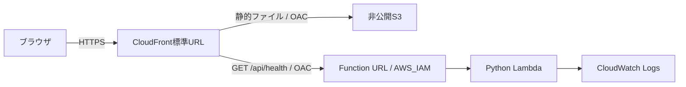

# Step 1: AWS配信基盤とヘルスチェック

## 実装範囲

Step 1は、確定済みの静的UIをAWSのURLで開き、CloudFrontからLambdaへの疎通を確認するための基盤。



- AWSリージョン: Tokyo (`ap-northeast-1`)。
- デフォルトの環境: `dev`。CDKスタックIDは`DeltaDenebDev`、CloudFormationスタック名は`delta-deneb-dev`。
- CloudFrontの標準ドメインを使い、独自ドメインと証明書は作成しない。
- S3はパブリックアクセスをブロックし、CloudFrontのOACに読み取りを許可する。
- Function URLは`AWS_IAM`認証。CloudFrontの指定ディストリビューションに`lambda:InvokeFunctionUrl`と`lambda:InvokeFunction`の両方を許可する。
- `/api/*`と`/api`はLambdaへ振り分け、APIレスポンスをキャッシュしない。APIの404を`index.html`へ変換しない。
- 静的ファイルは`web/`だけを配置する。ブラウザでは再検証し、CloudFrontでは最大5分キャッシュする。配置の更新時には`/*`を無効化し、完了を待つ。
- LambdaはPython 3.13 / ARM64、タイムアウト5秒。業務用Lambdaの権限はログ書き込みのみで、DynamoDBには接続しない。
- 業務用Lambdaのログは30日保持。サイト用S3バケットはバージョニングを有効にし、スタック削除時もバケットと業務用ログを保持する。

画面は引き続きブラウザ内の模擬データで動作する。走行戦略はブラウザ内だけに保存する。実データ取得はStep 2、UIと実データの接続はStep 3で実装する。

## 認証情報の取り扱い

このリポジトリと実装には、アクセスキー・シークレットキー・セッショントークン・プロファイル名を保存しない。AWSアカウントIDも固定しない。CDK CLIを利用してデプロイする際に、手元の認証からアカウントを解決する。

AWSログイン、初回のbootstrap、diff、deployはユーザーのPCで実行する。認証情報や設定ファイルをチャットへ渡す必要はない。

## 1. ローカルの準備

必要環境はPython 3.12以降、Node.js 22以降とnpm。デプロイするPCにはAWS CLI v2と利用するAWS認証設定も必要。

```sh
cd /Users/siroyan/workspace/delta-deneb
git switch codex/step1-aws-foundation

python3.12 -m venv .venv
.venv/bin/python -m pip install -r requirements-dev.txt
npm ci
```

Python 3.13などを利用する場合は、`python3.12`をそのコマンド名へ置き換える。依存バージョンは`requirements*.txt`と`package-lock.json`で固定している。

テストと認証不要のテンプレート生成:

```sh
npm test
npm run test:infra
npm run synth:offline
```

`synth:offline`はCDKアプリを直接実行し、AWSへの問い合わせや認証処理を行わず`cdk.out/`にテンプレートを生成する。`cdk.out/DeltaDenebDev.template.json`を確認できる。アカウント部分はCloudFormationの擬似パラメーターで解決し、ダミーのアカウントIDを埋め込まない。

## 2. 手元でAWSの接続先を確認

`YOUR_PROFILE`は自分のPCで設定したプロファイル名に置き換える。

```sh
aws configure list-profiles
aws sts get-caller-identity --profile YOUR_PROFILE --query Account --output text
```

この結果は自分のPCで確認すればよく、チャットへ貼り付ける必要はない。プロファイルが未設定の場合は、普段利用する認証方式で先に設定する。[AWS CLIの認証設定](https://docs.aws.amazon.com/cli/latest/userguide/cli-chap-authentication.html)と[プロファイル設定](https://docs.aws.amazon.com/cli/latest/userguide/cli-configure-files.html)を参照。

アカウントIDは[AWSコンソール右上のアカウントメニューからも確認できる](https://docs.aws.amazon.com/accounts/latest/reference/manage-acct-identifiers.html)。

## 3. 手元でデプロイ

初回のみ、CDK配布用のバケット・ロールなどを作成するbootstrapを実行する。

```sh
npm run cdk -- bootstrap --profile YOUR_PROFILE
```

差分を確認してからデプロイする。

```sh
npm run cdk -- diff DeltaDenebDev --profile YOUR_PROFILE
npm run cdk -- deploy DeltaDenebDev --profile YOUR_PROFILE --outputs-file cdk-outputs.dev.json
```

CDKはIAMポリシーなどの差分を表示する。`--require-approval never`は設定していない。リージョンはコードでTokyoに固定している。

主な出力:

| 出力 | 用途 |
| --- | --- |
| `SiteUrl` | ログイン不要のデモ画面 |
| `HealthUrl` | CloudFront経由のLambda疎通確認 |
| `StaticBucketName` | サイト用の非公開バケット |
| `ApiFunctionName` | 業務用Lambdaの確認 |
| `ApiLogGroupName` | 業務用Lambdaのログ確認 |
| `FunctionUrl` | IAM認証で保護されたオリジン。未認証の直接アクセスは403が正常 |

`cdk-outputs.dev.json`はGit管理対象外。実行時に使うプロファイルやアカウント情報をソースへ追記する必要はない。

## 4. デプロイ結果の確認

以下のスクリプトはPython標準ライブラリだけで動作し、AWS認証情報やAWS SDKを利用しない。

```sh
python3 scripts/check_deployment.py --outputs cdk-outputs.dev.json
```

確認する内容:

1. CloudFrontのURLでUIのHTMLを取得できる。
2. JavaScriptのMIMEタイプが正しく、コースJSONも取得できる。
3. `/api/health`が200と`status: ok`を返し、`Cache-Control: no-store`になっている。
4. 未定義APIがHTMLではなくJSONの404を返す。
5. Function URLへの未認証の直接アクセスが403になる。
6. S3への未認証の直接アクセスが403になる。

`SiteUrl`をブラウザで開いて、模擬データの自動更新、北が上のコース図、戦略JSONの読み込みも確認する。CloudFront側でGETとHEADに限定しているため、それ以外のメソッドはオリジン到達前に拒否される場合がある。

ヘルスチェックの例:

```json
{
  "status": "ok",
  "service": "delta-deneb",
  "stage": "dev",
  "step": 1,
  "timestamp": "2026-10-17T00:00:00Z"
}
```

## 現在の確認状況

2026-10-17に、認証なしで次を確認した。

- Python側25件: ヘルスチェック、CDKの権限・キャッシュ・依存関係、配布パッケージ、デプロイ確認スクリプトのテストが成功。
- JavaScript側16件: 既存の模擬API・戦略パーサーのテストが成功。
- アカウント未指定のオフラインsynthが成功。Tokyo向けの18リソースを生成し、追加のコンテキスト問い合わせはない。
- 固定済みのNode依存を、空の作業ディレクトリで`npm ci`によりインストールできることを確認。

AWSへのbootstrap・diff・deployと実環境の疎通確認は未実行。ユーザーの手元で実行する項目として分離している。デプロイ確認スクリプトのテストはHTTP応答を模擬しており、実AWSでの成功を示すものではない。

Step 1の実環境での完了条件は、`SiteUrl`でデモが開き、上記のデプロイ確認がすべて成功すること。

## 更新・保持・次の段階

静的UIを更新した場合も同じ`cdk deploy`で配信する。独自のS3同期コマンドや手動でのパブリック公開は不要。

スタック削除時もサイトバケットと業務用ログは保持する設計。削除後に同じスタックを作り直すと、新しいバケットを作成する場合がある。既存のIoT Core、DynamoDB、SiteWise、Grafanaのリソースは、このスタックの管理・削除対象に含めない。

Step 2ではDynamoDBのキー・受信時刻・走行の識別を確認し、テーブルの読み取り権限と取得APIを追加する。Step 3では実APIにUIを接続する。実データを公開する前に、共有URLの閲覧方式も確定する。

参考: [S3用OAC](https://docs.aws.amazon.com/AmazonCloudFront/latest/DeveloperGuide/private-content-restricting-access-to-s3.html)、[Lambda Function URL用OAC](https://docs.aws.amazon.com/AmazonCloudFront/latest/DeveloperGuide/private-content-restricting-access-to-lambda.html)。
