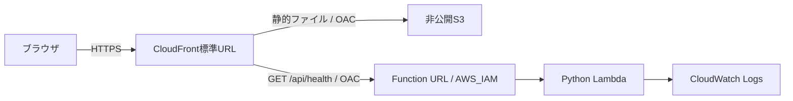

# Step 1: AWS配信基盤とヘルスチェック

この手順はDev ContainerとIAMユーザーのアクセスキーによる認証を前提とする。すべてのコマンドは、コンテナ内のターミナルでリポジトリのルート`/workspaces/delta-deneb`から実行する。ホスト側ではDocker・VS Codeの起動とブラウザ操作を行う。

## 実装範囲

Step 1は、確定済みの静的UIをAWSのURLで開き、CloudFrontからLambdaへの疎通を確認するための基盤。



- AWSリージョン: Tokyo (`ap-northeast-1`)。
- デフォルトの環境: `dev`。CDKスタックIDは`DeltaDenebDev`、CloudFormationスタック名は`delta-deneb-dev`。
- CloudFrontの標準ドメインを使い、独自ドメインと証明書は作成しない。
- S3はパブリックアクセスをブロックし、CloudFrontのOACに読み取りを許可する。
- Function URLは`AWS_IAM`認証。CloudFrontの指定ディストリビューションに`lambda:InvokeFunctionUrl`と`lambda:InvokeFunction`の両方を許可する。
- `/api/*`と`/api`はLambdaへ振り分け、APIレスポンスをキャッシュしない。APIの404を`index.html`へ変換しない。
- 静的ファイルは`web/`だけを配置する。ブラウザでは再検証し、CloudFrontでは最大5分キャッシュする。配置の更新時には`/*`を無効化し、完了を待つ。
- LambdaはPython 3.13 / ARM64、タイムアウト5秒。業務用Lambdaの権限はログ書き込みのみで、DynamoDBには接続しない。
- 業務用Lambdaのログは30日保持。サイト用S3バケットはバージョニングを有効にし、スタック削除時もバケットと業務用ログを保持する。

画面は引き続きブラウザ内の模擬データで動作する。走行戦略はブラウザ内だけに保存する。実データ取得はStep 2、UIと実データの接続はStep 3で実装する。

## 認証情報の取り扱い

アクセスキーID・シークレットアクセスキーは、ユーザー自身がコンテナ内のAWS CLIへ入力する。チャットやリポジトリには保存しない。AWSアカウントIDもコードに固定せず、デプロイ時にコンテナ内のAWS認証から解決する。

この手順ではProfile（認証情報と接続先に付ける名前）を`delta-deneb-dev`に統一する。Profileの設定、初回のbootstrap、diff、deployはユーザー自身がコンテナ内で実行する。

## 1. Dev Containerを開く

ホスト側にはDockerとVS Code・Dev Containers拡張を用意する。Python・Node.js・npm・uv・AWS CLIのホストへのインストールは不要。

1. Dockerを起動する。
2. VS Codeで`delta-deneb`のリポジトリフォルダを開く。
3. コマンドパレットから「Dev Containers: Reopen in Container」を実行する。
4. ビルドと初期化が完了したら、VS Codeで新しいターミナルを開く。

Python 3.13、Node.js 24、npm、uv、AWS CLI v2がコンテナ内に揃う。初期化時に`uv sync --locked`と`npm ci`が自動実行されるため、依存関係を手動でインストールする必要はない。

コンテナ内の作業フォルダへ移動する。

```sh
cd /workspaces/delta-deneb
```

Pythonの依存関係は`pyproject.toml`と`uv.lock`、Node.jsの依存関係は`package-lock.json`で管理する。Pythonの仮想環境はuvがコンテナ内で管理し、手動で有効化する必要はない。依存関係の更新やコンテナの再ビルドについては[Dev Containerの手順](devcontainer.md)を参照。

テストと認証不要のテンプレート生成:

```sh
npm test
npm run test:infra
npm run synth:offline
```

Python側の処理は、直接`uv run --locked python -m pytest`と`uv run --locked python app.py`でも実行できる。CDK CLIからのアプリ起動も`uv run --locked`を使う。

`synth:offline`はCDKアプリを直接実行し、AWSへの問い合わせや認証処理を行わず`cdk.out/`にテンプレートを生成する。`cdk.out/DeltaDenebDev.template.json`を確認できる。アカウント部分はCloudFormationの擬似パラメーターで解決し、ダミーのアカウントIDを埋め込まない。

## 2. IAMユーザーのアクセスキーでProfileを設定する

ここからのAWS操作はユーザーが実行する。ホストのAWS認証情報は自動マウントされないため、コンテナ内にProfileを設定する。この方式ではSSO Start URLやSSO registration scopesの入力は不要。

### 2-1. アクセスキーを用意する

利用できるアクセスキーIDとシークレットアクセスキーを保管済みなら、手順2-2へ進む。新しく作成する場合は、ホスト側のブラウザでAWSコンソールを開く。

1. 「IAM」→「ユーザー」から、デプロイに使用する自分のIAMユーザーを選ぶ。
2. 「セキュリティ認証情報」→「アクセスキー」→「アクセスキーを作成」を選ぶ。
3. 用途は「コマンドラインインターフェイス（CLI）」を選び、画面の案内に従って作成する。
4. アクセスキーIDとシークレットアクセスキーを安全な場所に保管する。シークレットアクセスキーを取得できるのは作成時のみ。

詳しくは[AWS公式のIAMユーザー向け設定手順](https://docs.aws.amazon.com/cli/latest/userguide/cli-authentication-user.html)を参照。キーの作成権限がない場合は、AWSアカウントの管理者に確認する。

### 2-2. コンテナ内でProfileを作成する

Dev Container内のターミナルで実行する。

```sh
aws configure --profile delta-deneb-dev
```

対話形式の質問に、次を入力する。

| 質問 | 入力する内容 |
| --- | --- |
| `AWS Access Key ID` | 用意したアクセスキーID |
| `AWS Secret Access Key` | 用意したシークレットアクセスキー |
| `Default region name` | `ap-northeast-1` |
| `Default output format` | `json` |

キーは対話形式の入力欄にだけ入力し、コマンドへ直接埋め込まない。`aws configure sso`を実行中なら`Ctrl+C`で中断し、上のコマンドから設定する。

### 2-3. Profileと接続先を確認する

```sh
aws configure list-profiles
aws sts get-caller-identity --profile delta-deneb-dev --query Account --output text
```

一覧に`delta-deneb-dev`があり、表示されたアカウントIDがデプロイ先と一致することを確認する。結果をチャットへ貼り付ける必要はない。

アカウントIDは[AWSコンソール右上のアカウントメニューからも確認できる](https://docs.aws.amazon.com/accounts/latest/reference/manage-acct-identifiers.html)。

認証情報はコンテナ内の`~/.aws/credentials`、リージョン・出力形式は`~/.aws/config`に保存される。コンテナを停止・再開した場合はそのまま使えるが、作り直した場合は手順2-2から再設定する。ホストへのコピーや自動マウントは設定しない。

## 3. コンテナ内からデプロイする

デプロイ先のAWSアカウント・リージョンで初回のみ、CDK配布用のバケット・ロールなどを作成するbootstrapを実行する。コンテナを作り直しただけなら、bootstrapを繰り返す必要はない。

```sh
npm run cdk -- bootstrap --profile delta-deneb-dev
```

差分を確認してからデプロイする。

```sh
npm run cdk -- diff DeltaDenebDev --profile delta-deneb-dev
npm run cdk -- deploy DeltaDenebDev --profile delta-deneb-dev --outputs-file cdk-outputs.dev.json
```

CDKはIAMポリシーなどの差分を表示する。`--require-approval never`は設定していない。リージョンはコードでTokyoに固定している。

主な出力:

| 出力 | 用途 |
| --- | --- |
| `SiteUrl` | ログイン不要のデモ画面 |
| `HealthUrl` | CloudFront経由のLambda疎通確認 |
| `StaticBucketName` | サイト用の非公開バケット |
| `ApiFunctionName` | 業務用Lambdaの確認 |
| `ApiLogGroupName` | 業務用Lambdaのログ確認 |
| `FunctionUrl` | IAM認証で保護されたオリジン。未認証の直接アクセスは403が正常 |

`cdk-outputs.dev.json`はリポジトリのルートに生成され、Git管理対象外。次の確認手順でもこのファイルを使う。実行時に使うプロファイルやアカウント情報をソースへ追記する必要はない。

## 4. デプロイ結果の確認

デプロイに使ったコンテナ内で、以下のスクリプトを実行する。Python標準ライブラリだけで動作し、AWS認証情報やAWS SDKを利用しない。

```sh
uv run --locked python scripts/check_deployment.py --outputs cdk-outputs.dev.json
```

確認する内容:

1. CloudFrontのURLでUIのHTMLを取得できる。
2. JavaScriptのMIMEタイプが正しく、コースJSONも取得できる。
3. `/api/health`が200と`status: ok`を返し、`Cache-Control: no-store`になっている。
4. 未定義APIがHTMLではなくJSONの404を返す。
5. Function URLへの未認証の直接アクセスが403になる。
6. S3への未認証の直接アクセスが403になる。

`SiteUrl`をホスト側のブラウザで開いて、模擬データの自動更新、北が上のコース図、戦略JSONの読み込みも確認する。CloudFront側でGETとHEADに限定しているため、それ以外のメソッドはオリジン到達前に拒否される場合がある。

ヘルスチェックの例:

```json
{
  "status": "ok",
  "service": "delta-deneb",
  "stage": "dev",
  "step": 1,
  "timestamp": "2026-10-17T00:00:00Z"
}
```

## 現在の確認状況

2026-10-17に、認証なしで次を確認した。

- Python側25件: ヘルスチェック、CDKの権限・キャッシュ・依存関係、配布パッケージ、デプロイ確認スクリプトのテストが成功。
- `uv sync --locked`でPython 3.13の環境を構築し、`uv run --locked`でPython側テストとオフラインsynthが成功。
- Dev Container用イメージをARM64でビルドし、コンテナ内の初期化・全41件のテスト・オフラインsynth・UIのHTTP配信が成功。詳細は[Dev Containerの確認状況](devcontainer.md#確認状況)を参照。
- JavaScript側16件: 既存の模擬API・戦略パーサーのテストが成功。
- アカウント未指定のオフラインsynthが成功。Tokyo向けの18リソースを生成し、追加のコンテキスト問い合わせはない。
- 固定済みのNode依存を、空の作業ディレクトリで`npm ci`によりインストールできることを確認。

AWSへのbootstrap・diff・deployと実環境の疎通確認は未実行。上記の手順に従い、ユーザー自身がコンテナ内で実行する。デプロイ確認スクリプトのテストはHTTP応答を模擬しており、実AWSでの成功を示すものではない。

Step 1の実環境での完了条件は、`SiteUrl`でデモが開き、上記のデプロイ確認がすべて成功すること。

## 更新・保持・次の段階

静的UIを更新した場合も、コンテナ内から手順3と同じデプロイコマンドで配信する。独自のS3同期コマンドや手動でのパブリック公開は不要。

スタック削除時もサイトバケットと業務用ログは保持する設計。削除後に同じスタックを作り直すと、新しいバケットを作成する場合がある。既存のIoT Core、DynamoDB、SiteWise、Grafanaのリソースは、このスタックの管理・削除対象に含めない。

Step 2ではDynamoDBのキー・受信時刻・走行の識別を確認し、テーブルの読み取り権限と取得APIを追加する。Step 3では実APIにUIを接続する。実データを公開する前に、共有URLの閲覧方式も確定する。

参考: [S3用OAC](https://docs.aws.amazon.com/AmazonCloudFront/latest/DeveloperGuide/private-content-restricting-access-to-s3.html)、[Lambda Function URL用OAC](https://docs.aws.amazon.com/AmazonCloudFront/latest/DeveloperGuide/private-content-restricting-access-to-lambda.html)。
