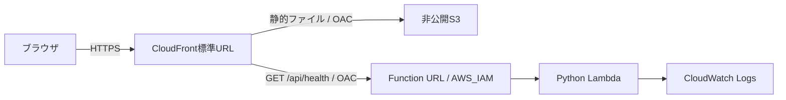

# Step 1: AWS配信基盤とヘルスチェック

Step 1のデプロイと確認が済んでいる場合は、[Step 2の更新手順](step2-deployment.md)へ進む。Step 2のヘルスチェックは`step: 2`になるため、確認コマンドにも`--step 2`を指定する。

この手順はDev Containerと、IAMユーザーによる`aws login`の一時認証を前提とする。すべてのコマンドは、コンテナ内のターミナルでリポジトリのルート`/workspaces/delta-deneb`から実行する。ホスト側ではDocker・VS Codeの起動とブラウザ操作を行う。

## 実装範囲

Step 1は、確定済みの静的UIをAWSのURLで開き、CloudFrontからLambdaへの疎通を確認するための基盤。



- AWSリージョン: Tokyo (`ap-northeast-1`)。
- デフォルトの環境: `dev`。CDKスタックIDは`DeltaDenebDev`、CloudFormationスタック名は`delta-deneb-dev`。
- CloudFrontの標準ドメインを使い、独自ドメインと証明書は作成しない。
- S3はパブリックアクセスをブロックし、CloudFrontのOACに読み取りを許可する。
- Function URLは`AWS_IAM`認証。CloudFrontの指定ディストリビューションに`lambda:InvokeFunctionUrl`と`lambda:InvokeFunction`の両方を許可する。
- `/api/*`と`/api`はLambdaへ振り分け、APIレスポンスをキャッシュしない。APIの404を`index.html`へ変換しない。
- 静的ファイルは`web/`だけを配置する。ブラウザでは再検証し、CloudFrontでは最大5分キャッシュする。配置の更新時には`/*`を無効化し、完了を待つ。
- LambdaはPython 3.13 / ARM64、タイムアウト5秒。業務用Lambdaの権限はログ書き込みのみで、DynamoDBには接続しない。
- 業務用Lambdaのログは30日保持。サイト用S3バケットはバージョニングを有効にし、スタック削除時もバケットと業務用ログを保持する。

画面は引き続きブラウザ内の模擬データで動作する。走行戦略はブラウザ内だけに保存する。実データ取得はStep 2、UIと実データの接続はStep 3で実装する。

## 認証情報の取り扱い

ユーザー自身がホスト側のブラウザでIAMユーザーとして認証し、表示された認証コードをコンテナ内のAWS CLIへ入力する。長期アクセスキーは作成しない。パスワード・MFAコード・CLI認証コード・一時認証情報をチャットやリポジトリへ送らない。AWSアカウントIDもコードに固定せず、デプロイ時にコンテナ内のAWS認証から解決する。

この手順では専用IAMユーザーを`delta-deneb-deployer`、Profile（認証方法と接続先に付ける名前）を`delta-deneb-login`とする。以前のアクセスキーやSSOの設定が残るProfileを再利用せず、一時認証用のProfileを新しく作る。AWS操作はユーザー自身が実行する。

## 1. Dev Containerを開く

ホスト側にはDockerとVS Code・Dev Containers拡張を用意する。Python・Node.js・npm・uv・AWS CLIのホストへのインストールは不要。

1. Dockerを起動する。
2. VS Codeで`delta-deneb`のリポジトリフォルダを開く。
3. コマンドパレットから「Dev Containers: Reopen in Container」を実行する。
4. ビルドと初期化が完了したら、VS Codeで新しいターミナルを開く。

Python 3.13、Node.js 24、npm、uv、AWS CLI v2がコンテナ内に揃う。初期化時に`uv sync --locked`と`npm ci`が自動実行されるため、依存関係を手動でインストールする必要はない。

コンテナ内の作業フォルダへ移動する。

```sh
cd /workspaces/delta-deneb
```

Pythonの依存関係は`pyproject.toml`と`uv.lock`、Node.jsの依存関係は`package-lock.json`で管理する。Pythonの仮想環境はuvがコンテナ内で管理し、手動で有効化する必要はない。依存関係の更新やコンテナの再ビルドについては[Dev Containerの手順](devcontainer.md)を参照。

テストと認証不要のテンプレート生成:

```sh
npm test
npm run test:infra
npm run synth:offline
```

Python側の処理は、直接`uv run --locked python -m pytest`と`uv run --locked python app.py`でも実行できる。CDK CLIからのアプリ起動も`uv run --locked`を使う。

`synth:offline`はCDKアプリを直接実行し、AWSへの問い合わせや認証処理を行わず`cdk.out/`にテンプレートを生成する。`cdk.out/DeltaDenebDev.template.json`を確認できる。アカウント部分はCloudFormationの擬似パラメーターで解決し、ダミーのアカウントIDを埋め込まない。

## 2. ブラウザ認証で一時認証用のProfileを設定する

ホストのAWS認証情報は自動マウントされないため、コンテナ内にProfileを設定する。`aws login`はAWS CLI 2.32.0以降で利用でき、用意したDev Containerの2.38.1は対応している。SSOのURLやregistration scopesは使わない。[AWS公式のブラウザ認証手順](https://docs.aws.amazon.com/cli/latest/userguide/cli-configure-sign-in.html)を参照。

### 2-1. 専用IAMユーザーとMFAを設定する

ホスト側のブラウザで、IAMユーザーを管理できる既存の管理者としてAWSコンソールを開く。

1. 「IAM」→「ユーザー」→「ユーザーの作成」を開き、名前を`delta-deneb-deployer`にする。
2. AWSマネジメントコンソールへのアクセスを有効にし、IAMユーザーとしてログインするためのパスワードを設定する。`aws login`ではブラウザでの認証にコンソールアクセスを使用する。
3. 許可ポリシーとして`SignInLocalDevelopmentAccess`を付与する。既存の管理者ユーザーの権限をコピーしない。
4. ユーザー作成後、「セキュリティ認証情報」→「多要素認証（MFA）」からMFAデバイスを割り当てる。パスキー・セキュリティキー、または認証アプリを使用する。
5. 専用ユーザーのサインインURL・ユーザー名・パスワードを自分で保管する。アクセスキーは作成しない。

`SignInLocalDevelopmentAccess`はCLIのブラウザ認証を許可するポリシーで、S3やLambdaを作成する権限は含まない。デプロイ権限は手順2-4で別に設定する。

参考: [IAMユーザーの作成](https://docs.aws.amazon.com/IAM/latest/UserGuide/id_users_create.html)、[MFAの設定](https://docs.aws.amazon.com/IAM/latest/UserGuide/id_credentials_mfa_enable_virtual.html)、[SignInLocalDevelopmentAccessの権限](https://docs.aws.amazon.com/aws-managed-policy/latest/reference/SignInLocalDevelopmentAccess.html)。

### 2-2. コンテナ内からログインする

Dev Container内のターミナルで実行する。

```sh
aws configure set region ap-northeast-1 --profile delta-deneb-login
aws configure set output json --profile delta-deneb-login
aws login --profile delta-deneb-login --remote
```

表示されたURLをホスト側のブラウザで開き、`delta-deneb-deployer`としてサインインする。管理者ユーザーのブラウザセッションが選ばれていないことを確認する。MFA認証後、ブラウザに表示された認証コードを、自分のコンテナ内ターミナルの入力欄へ貼り付ける。

### 2-3. Profileと接続先を確認する

```sh
aws configure list-profiles
aws sts get-caller-identity --profile delta-deneb-login
```

一覧に`delta-deneb-login`があり、`Account`がデプロイ先、`Arn`が`user/delta-deneb-deployer`で終わることを確認する。結果をチャットへ貼り付ける必要はない。この確認の成功は認証を確認するもので、デプロイ権限の確認は手順2-4で行う。

アカウントIDは[AWSコンソール右上のアカウントメニューからも確認できる](https://docs.aws.amazon.com/accounts/latest/reference/manage-acct-identifiers.html)。

Profileはコンテナ内の`~/.aws/config`、一時認証情報は`~/.aws/login/cache/`に保存される。有効期限が切れたら同じ`aws login`を再実行する。コンテナを作り直した場合は手順2-2から再設定する。

作業終了時にログアウトする場合:

```sh
aws logout --profile delta-deneb-login
```

### 2-4. CDKのデプロイ基盤と権限を準備する

対象アカウントのTokyoリージョンには既に`CDKToolkit`があるが、ユーザーの確認ではリソースは`AWS::S3::Bucket`のみで、`CloudFormationExecutionRole`は存在しない。これは旧形式のbootstrapの構成と一致する。独自構成の可能性もあるため、旧形式と断定はしない。[旧形式と現行形式の違い](https://docs.aws.amazon.com/cdk/v2/guide/bootstrapping-env.html)を参照。

既存のスタックとS3バケットは保持する。今回のCDKアプリは現行形式のbootstrapで用意されるIAMロール・配布バケット・SSMパラメーターなどを利用するため、このS3バケットだけの構成を、そのままデプロイ基盤として使えるとは扱わない。

ここでは専用の配布基盤`DeltaDenebDevToolkit`を新しく作成し、手順2-1で作成した専用ユーザーへデプロイ権限を付与する。以下の2-4-1〜2-4-5を順に実行すれば、この章だけで初回準備が完了する。AWSを操作するコマンドはユーザー自身がDev Container内で実行する。

使い分ける名前は次のとおり。

| 名前 | 用途 |
| --- | --- |
| `delta-deneb-login` | 専用ユーザー`delta-deneb-deployer`のProfile。通常のアプリデプロイに使用 |
| `delta-deneb-bootstrap` | 既存の管理者のProfile。配布基盤の初回作成・更新に使用 |
| `DeltaDenebDevToolkit` | 今回作成する専用の配布基盤のCloudFormationスタック名 |
| `denebdev1` | 配布用バケットやロールなどを識別するqualifier。アプリ側も同じ値を参照 |
| `delta-deneb-dev` | 手順3でデプロイするアプリのCloudFormationスタック名 |

#### 2-4-1. 最新のコードと依存関係を取得する

Dev Container内で、作業中のブランチが`codex/step1-aws-foundation`であることを確認してから更新する。

```sh
cd /workspaces/delta-deneb
git branch --show-current
git pull --ff-only
uv sync --locked
npm ci
```

別のブランチだった場合は、未コミットの変更を確認してから`git switch codex/step1-aws-foundation`で切り替える。更新に失敗した場合は、その原因を解消してから次へ進む。

#### 2-4-2. 初回準備用のテンプレートを生成する

```sh
npm run prepare:bootstrap
npm run synth:offline
```

初回準備用のCloudFormationテンプレートが`bootstrap.out/dev.template.json`に生成される。アプリ側のテンプレートは`cdk.out/DeltaDenebDev.template.json`に生成される。どちらの生成処理もAWSに接続せず、リソースはまだ作成されない。

専用ユーザー名を`delta-deneb-deployer`以外にした場合だけ、最初のコマンドの代わりに次を実行する。末尾のユーザー名は、自分で作成したものへ置き換える。

```sh
npm run prepare:bootstrap -- --deployer-user-name 自分で作成したIAMユーザー名
```

#### 2-4-3. 初回準備用の管理者Profileを設定する

CloudFormation、IAM、S3、ECR、SSMのリソースを作成できる、既存の管理者を使う。普段使う`delta-deneb-deployer`へ管理者権限を追加する必要はない。

```sh
aws configure set region ap-northeast-1 --profile delta-deneb-bootstrap
aws configure set output json --profile delta-deneb-bootstrap
aws login --profile delta-deneb-bootstrap --remote
```

表示されたURLをホスト側のブラウザで開き、既存の管理者で認証する。専用ユーザーのブラウザセッションが選ばれていないことを確認する。ブラウザに表示された認証コードは、自分のコンテナ内ターミナルへ入力する。

続けて接続先とログインしたユーザーを確認する。

```sh
aws sts get-caller-identity --profile delta-deneb-bootstrap
```

`Account`が手順2-3で確認したアカウントと同じこと、`Arn`が初回準備に使う管理者であることを自分で確認する。認証コードや認証情報をチャットへ送る必要はない。

#### 2-4-4. 作成内容と権限を確認して配布基盤を作成する

VS Codeで`bootstrap.out/dev.template.json`を開く。今回のテンプレートは、主に次のリソースと権限を設定する。

- 配布用S3バケット、ECRリポジトリ、CDK用IAMロール、bootstrapバージョンを記録するSSMパラメーターを作成する。ECRはCDK標準テンプレートとの互換性のために用意し、専用ユーザーにはイメージ配布ロールの利用を許可しない。
- 作成済みの`delta-deneb-deployer`へ、専用ロールを引き受ける権限と、対象スタック・バージョン情報の読み取り権限を付与する。新しいユーザーやアクセスキーは作成しない。
- 通常のデプロイ先は`delta-deneb-dev`スタックに限定する。専用ユーザーには、配布基盤自体を更新する権限を付与しない。
- CloudFormation実行ロールに`AdministratorAccess`を付けず、アプリ配布に必要な許可と権限の上限を設定する。アプリ用IAMロールにも権限の上限を必須にし、デプロイ経由での上限の削除・変更を制限する。
- S3、Lambda、ログの操作対象は名前・アカウント・リージョンで絞る。DynamoDBやIoTへのアクセス権限は含めない。
- CloudFrontディストリビューションの更新・削除は`Project=delta-deneb`と`Environment=dev`のタグで制限する。ただし識別タグのない既存ディストリビューションへ同じタグを付ける余地は残るため、タグによる厳密な所有権分離を保証する構成ではない。
- **CloudFrontのキャッシュポリシー、オリジンリクエストポリシー、OACの一部APIはリソース単位でIAM権限を絞れず、該当する設定の作成・取得・更新・削除権限がアカウント全体に及ぶ。** 他のシステムで共有する設定へ影響する余地がある。ロググループ一覧とCloudFormationのテンプレート概要の読み取り権限も残る。

内容を確認したら、管理者Profileで次を実行する。

```sh
aws cloudformation deploy \
  --template-file bootstrap.out/dev.template.json \
  --stack-name DeltaDenebDevToolkit \
  --capabilities CAPABILITY_NAMED_IAM \
  --region ap-northeast-1 \
  --profile delta-deneb-bootstrap \
  --tags Project=delta-deneb Environment=dev
```

`CAPABILITY_NAMED_IAM`は、名前付きIAMリソースをテンプレートが作成することへの確認指定。このコマンドは変更セットを作成して実行し、スタックの処理完了を待つ。

スタック名は必ず`DeltaDenebDevToolkit`を使う。既存の`CDKToolkit`を指定したり、引数なしの`cdk bootstrap`を実行したりしない。

#### 2-4-5. 作成結果を確認して専用ユーザーへ戻す

```sh
aws cloudformation describe-stacks \
  --stack-name DeltaDenebDevToolkit \
  --region ap-northeast-1 \
  --profile delta-deneb-bootstrap \
  --query 'Stacks[0].{Status:StackStatus,Outputs:Outputs}'
```

初回作成では`Status`が`CREATE_COMPLETE`であることを確認する。失敗した場合は、AWSコンソールのTokyoリージョンで「CloudFormation」→「DeltaDenebDevToolkit」→「イベント」を開き、失敗したリソースの理由を確認してから進める。

成功したら管理者Profileからログアウトし、通常のデプロイ用Profileを確認する。

```sh
aws logout --profile delta-deneb-bootstrap
aws sts get-caller-identity --profile delta-deneb-login
```

専用ユーザーの認証期限が切れていた場合は、次を実行して専用ユーザーで再認証し、本人確認を再実行する。

```sh
aws login --profile delta-deneb-login --remote
aws sts get-caller-identity --profile delta-deneb-login
```

`Arn`が`user/delta-deneb-deployer`で終わることを確認したら、初回準備は完了。次の手順3へ進む。独自のユーザー名を使っている場合は、その名前と一致することを確認する。

配布基盤の検証状況や将来の更新・`prod`環境については、[専用CDK配布基盤の補足](bootstrap.md#検証状況と更新)を参照。

## 3. コンテナ内からデプロイする

手順2-4で`DeltaDenebDevToolkit`の作成が成功してから、専用ユーザーで差分を確認してデプロイする。初回準備用の管理者Profileは使わない。

```sh
npm run cdk -- diff DeltaDenebDev --profile delta-deneb-login
npm run cdk -- deploy DeltaDenebDev --profile delta-deneb-login --outputs-file cdk-outputs.dev.json
```

CDKはIAMポリシーなどの差分を表示する。`--require-approval never`は設定していない。リージョンはコードでTokyoに固定している。

主な出力:

| 出力 | 用途 |
| --- | --- |
| `SiteUrl` | ログイン不要のデモ画面 |
| `HealthUrl` | CloudFront経由のLambda疎通確認 |
| `StaticBucketName` | サイト用の非公開バケット |
| `ApiFunctionName` | 業務用Lambdaの確認 |
| `ApiLogGroupName` | 業務用Lambdaのログ確認 |
| `FunctionUrl` | IAM認証で保護されたオリジン。未認証の直接アクセスは403が正常 |

`cdk-outputs.dev.json`はリポジトリのルートに生成され、Git管理対象外。次の確認手順でもこのファイルを使う。実行時に使うプロファイルやアカウント情報をソースへ追記する必要はない。

### 3-1. `lambda:PublishLayerVersion`の権限不足で失敗した場合

以前の配布基盤テンプレートでは、静的ファイル配布用のLambdaレイヤーを作成する権限が不足していた。`DeploySiteAwsCliLayer...`の作成が`lambda:PublishLayerVersion`のAccessDeniedで失敗した場合は、アプリと配布基盤の両方を更新する。

修正版はレイヤー名を`delta-deneb-dev-site-deployment-awscli`に固定し、そのレイヤーの公開・読み取り・削除だけをCloudFormation実行ロールに許可する。実行ロールのポリシーと権限の上限を同時に更新する必要があるため、専用ユーザーへのポリシーの手動追加では解決しない。

1. Dev Container内で最新の修正と生成済みテンプレートを用意する。

   ```sh
   git pull --ff-only
   uv sync --locked
   npm ci
   npm run prepare:bootstrap
   npm run synth:offline
   ```

   独自のIAMユーザー名を使っている場合は、手順2-4-2と同じ`--deployer-user-name`を付けて生成する。

2. 手順2-4-3の管理者Profileでログインし、`Arn`が管理者であることを確認する。

   ```sh
   aws login --profile delta-deneb-bootstrap --remote
   aws sts get-caller-identity --profile delta-deneb-bootstrap
   ```

3. 手順2-4-4と同じコマンドで`DeltaDenebDevToolkit`を更新する。既存の配布基盤が更新されるため、新しいスタックやユーザーは不要。

   ```sh
   aws cloudformation deploy \
     --template-file bootstrap.out/dev.template.json \
     --stack-name DeltaDenebDevToolkit \
     --capabilities CAPABILITY_NAMED_IAM \
     --region ap-northeast-1 \
     --profile delta-deneb-bootstrap \
     --tags Project=delta-deneb Environment=dev

   aws cloudformation describe-stacks \
     --stack-name DeltaDenebDevToolkit \
     --region ap-northeast-1 \
     --profile delta-deneb-bootstrap \
     --query 'Stacks[0].StackStatus' \
     --output text
   ```

   `UPDATE_COMPLETE`を確認してから次へ進む。

4. 管理者からログアウトし、専用ユーザーでアプリの現在の状態を確認する。

   ```sh
   aws logout --profile delta-deneb-bootstrap
   aws sts get-caller-identity --profile delta-deneb-login
   aws cloudformation describe-stacks \
     --stack-name delta-deneb-dev \
     --region ap-northeast-1 \
     --profile delta-deneb-login \
     --query 'Stacks[0].StackStatus' \
     --output text
   ```

   認証期限が切れていた場合は、`aws login --profile delta-deneb-login --remote`で専用ユーザーとして再認証する。失敗したアプリスタックの状態によって、次の対応が変わる。

   | アプリスタックの状態 | 次の対応 |
   | --- | --- |
   | `CREATE_FAILED` / `UPDATE_FAILED` | 修正後のテンプレートで、手順3のアプリデプロイを再実行する |
   | `UPDATE_ROLLBACK_COMPLETE` | 手順3のアプリデプロイを再実行する |
   | `ROLLBACK_COMPLETE` | 初回作成が取り消された状態。下記の手順で失敗したアプリスタックを削除してから、再作成する |
   | `*_IN_PROGRESS` | 処理が終わるまで待ち、状態を再確認する |
   | `ROLLBACK_FAILED` / `UPDATE_ROLLBACK_FAILED` / `DELETE_FAILED` | CloudFormationのイベントで失敗理由を確認し、復旧方法を判断する。削除や再デプロイを繰り返さない |

   **`ROLLBACK_COMPLETE`の場合だけ**、以下で失敗したアプリスタックを削除する。確認画面で対象が`delta-deneb-dev`であることを確かめる。保持対象のサイト用S3バケットとログが既に作成されていた場合、それらは残り、再作成時には新しいリソースが作成される。既存の`CDKToolkit`や専用配布基盤`DeltaDenebDevToolkit`は削除対象に指定しない。

   ```sh
   npm run cdk -- destroy DeltaDenebDev --profile delta-deneb-login
   ```

5. アプリを再デプロイし、成功後に疎通を確認する。

   ```sh
   npm run cdk -- deploy DeltaDenebDev --profile delta-deneb-login --outputs-file cdk-outputs.dev.json
   uv run --locked python scripts/check_deployment.py --outputs cdk-outputs.dev.json
   ```

参考: [Lambdaのアクションと対象リソース](https://docs.aws.amazon.com/service-authorization/latest/reference/list_lambda.html)、[CloudFormationで失敗した作成・更新の再開](https://docs.aws.amazon.com/AWSCloudFormation/latest/UserGuide/stack-failure-options.html)。

## 4. デプロイ結果の確認

デプロイに使ったコンテナ内で、以下のスクリプトを実行する。Python標準ライブラリだけで動作し、AWS認証情報やAWS SDKを利用しない。

```sh
uv run --locked python scripts/check_deployment.py --outputs cdk-outputs.dev.json
```

確認する内容:

1. CloudFrontのURLでUIのHTMLを取得できる。
2. JavaScriptのMIMEタイプが正しく、コースJSONも取得できる。
3. `/api/health`が200と`status: ok`を返し、`Cache-Control: no-store`になっている。
4. 未定義APIがHTMLではなくJSONの404を返す。
5. Function URLへの未認証の直接アクセスが403になる。
6. S3への未認証の直接アクセスが403になる。

`SiteUrl`をホスト側のブラウザで開いて、模擬データの自動更新、北が上のコース図、戦略JSONの読み込みも確認する。CloudFront側でGETとHEADに限定しているため、それ以外のメソッドはオリジン到達前に拒否される場合がある。

ヘルスチェックの例:

```json
{
  "status": "ok",
  "service": "delta-deneb",
  "stage": "dev",
  "step": 1,
  "timestamp": "2026-10-17T00:00:00Z"
}
```

## 現在の確認状況

2026-10-17に、認証なしで次を確認した。

- Python側34件: ヘルスチェック、CDKの権限・キャッシュ・依存関係、配布パッケージ、デプロイ確認スクリプト、専用bootstrapの信頼関係・権限上限のテストが成功。
- `uv sync --locked`でPython 3.13の環境を構築し、`uv run --locked`でPython側テストとオフラインsynthが成功。
- Dev Container用イメージをARM64でビルドし、コンテナ内の初期化・オフラインsynth・UIのHTTP配信が成功。bootstrap追加後の全50件のテストもコンテナ内で成功。詳細は[Dev Containerの確認状況](devcontainer.md#確認状況)を参照。
- JavaScript側16件: 既存の模擬API・戦略パーサーのテストが成功。
- アカウント未指定のオフラインsynthが成功。Tokyo向けの18リソースを生成し、追加のコンテキスト問い合わせはない。
- 固定済みのNode依存を、空の作業ディレクトリで`npm ci`によりインストールできることを確認。

2026-10-18に、配布用Lambdaレイヤーの権限不足を修正した。修正前に不足を再現するテストを追加し、修正後はコンテナ内でPython側37件とオフラインsynthが成功した。`dev`・`prod`の専用bootstrapテンプレートも再生成し、`cfn-lint 1.57.2`で静的検証が成功した。アプリ側も既存のW3005警告だけを除外して静的検証した。

これらの開発側の検証ではAWSへのbootstrap・diff・deployは実行していない。修正版のAWS操作と実環境の疎通確認は、上記の手順に従いユーザー自身がコンテナ内で実行する。デプロイ確認スクリプトのテストはHTTP応答を模擬しており、実AWSでの成功を示すものではない。

Step 1の実環境での完了条件は、`SiteUrl`でデモが開き、上記のデプロイ確認がすべて成功すること。

## 更新・保持・次の段階

静的UIを更新した場合も、コンテナ内から手順3と同じデプロイコマンドで配信する。独自のS3同期コマンドや手動でのパブリック公開は不要。

スタック削除時もサイトバケットと業務用ログは保持する設計。削除後に同じスタックを作り直すと、新しいバケットを作成する場合がある。既存のIoT Core、DynamoDB、SiteWise、Grafanaのリソースは、このスタックの管理・削除対象に含めない。

Step 2ではDynamoDBのキー・受信時刻・走行の識別を確認し、テーブルの読み取り権限と取得APIを追加する。Step 3では実APIにUIを接続する。実データを公開する前に、共有URLの閲覧方式も確定する。

参考: [S3用OAC](https://docs.aws.amazon.com/AmazonCloudFront/latest/DeveloperGuide/private-content-restricting-access-to-s3.html)、[Lambda Function URL用OAC](https://docs.aws.amazon.com/AmazonCloudFront/latest/DeveloperGuide/private-content-restricting-access-to-lambda.html)。
