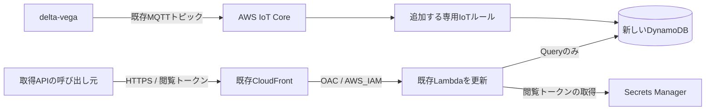

# Step 2: 新しいDynamoDBへの保存と走行データ取得API

Step 1で公開した同じCloudFront URLとアプリスタックを更新する。すべてのコマンドはDev Container内の`/workspaces/delta-deneb`で、ユーザー自身が実行する。認証情報や閲覧トークンをチャットへ渡す必要はない。

Step 2では新しいDynamoDBとIoTルールを作成する。この文書はStep 2ブランチの配布手順。画面と共有リンクの接続を含む最新の実装は[Step 3の手順](step3-deployment.md)を参照。

## 追加する構成



| 項目 | dev環境の設定 |
| --- | --- |
| リージョン | Tokyo / `ap-northeast-1` |
| アプリスタック | `delta-deneb-dev` / CDK ID `DeltaDenebDev` |
| 配布基盤スタック | `DeltaDenebDevToolkit` |
| DynamoDBテーブル | `delta-deneb-dev-telemetry` |
| 時刻順のGSI | `by-machine-received-at` |
| 追加するIoTルール | `delta_deneb_dev_telemetry` |
| 購読するトピック | `v0/delta_machine_alpha/telemetry/racing_data` |
| サーバー側の車両ID | `delta_machine_alpha` |
| 閲覧トークンの保管先 | `delta-deneb/dev/viewer-token` |

既存のIoT接続先・証明書・送信トピックはそのまま使用する。既存のIoTルールやDynamoDB、SiteWise、Grafanaはこのスタックの管理対象にしない。同じメッセージを新しいルールでも処理するため、既存の保存先にも従来どおりデータが送られる。既存データの移行や、デプロイ前のメッセージの取り込みは行わない。

車両IDはトピックに対応する固定値をルールで付与する。MQTT本文の`machine_id`やブラウザの入力で保存・取得対象を変更しない。変更する場合は`infra/deployment_settings.py`のトピックと車両ID、関連する権限・テストを合わせて見直す。

## 1. Step 2のコードと依存関係を取得する

```sh
cd /workspaces/delta-deneb
git fetch origin
git switch codex/step2-telemetry-api
git pull --ff-only
uv sync --locked
npm ci
npm test
npm run test:infra
npm run synth:offline
npm run prepare:bootstrap
```

未コミットの変更がある場合は、自分の変更を確認してからブランチを切り替える。Step 2はデプロイ済みのStep 1の変更を含んでいる。

API用のboto3と依存パッケージも`uv.lock`で固定する。synth時にAPIのソースと必要なSDKだけを`cdk.out/DeltaDenebDev.api-package/`へまとめ、Lambdaへ配布する。テスト用の生成物はテスト専用の一時フォルダへ分離する。ホストへの追加インストールや、Docker内からのDocker操作は不要。この生成処理はAWSへ接続しない。

## 2. 管理者で配布基盤の権限を更新する

**アプリを更新する前に、この手順を実行する。** Step 1の権限上限では、DynamoDB・IoTルール・Secrets Managerを利用できない。

既存の管理者を使う`delta-deneb-bootstrap`でログインする。ブラウザでは`delta-deneb-deployer`ではなく、既存の管理者を選択する。

```sh
aws login --profile delta-deneb-bootstrap --remote
aws sts get-caller-identity --profile delta-deneb-bootstrap
```

`Account`がStep 1と同じこと、`Arn`が管理者を示していることを確認する。Profile名を指定するだけでは権限は変わらない。

VS Codeで`bootstrap.out/dev.template.json`を確認する。追加する権限は次のとおり。

- CloudFormation実行ロールに、上表の専用テーブル・IoTルール・Secretの管理権限と、専用の取り込みロールをIoTへ渡す権限を追加する。既存の共有`CDKToolkit`の更新権限は追加しない。
- アプリ用ロールの権限上限に、専用車両のテーブルとGSIへの`Query`、専用テーブルへの`PutItem`、専用Secretの読み取りを追加する。実際に付与するポリシーは役割ごとに分け、APIは読み取り、IoTの取り込みロールは書き込みだけにする。
- 専用ユーザーには、手元でAPIを確認するために、この閲覧用Secretを読み取る権限を追加する。Secretの更新権限は付与しない。
- AWSでのトークン自動生成に必要な`secretsmanager:GetRandomPassword`を許可する。このAPIは対象リソースを指定できないため、`Resource: "*"`を使用する。
- 権限上限ポリシーをIAMのサイズ上限に収めるため、同じEffect・Resource・Conditionの文だけを統合し、説明用のSidを除いている。CloudFormation実行ロールのポリシーとの許可内容の一致をテストしている。

Step 1から残るCloudFront共有設定APIの権限範囲は、[配布基盤の説明](bootstrap.md#作成されるものと権限の範囲)を参照。

```sh
aws cloudformation deploy \
  --template-file bootstrap.out/dev.template.json \
  --stack-name DeltaDenebDevToolkit \
  --capabilities CAPABILITY_NAMED_IAM \
  --region ap-northeast-1 \
  --profile delta-deneb-bootstrap \
  --tags Project=delta-deneb Environment=dev

aws cloudformation describe-stacks \
  --stack-name DeltaDenebDevToolkit \
  --region ap-northeast-1 \
  --profile delta-deneb-bootstrap \
  --query 'Stacks[0].StackStatus' \
  --output text
```

`UPDATE_COMPLETE`を確認してから次へ進む。専用IAMユーザーの名前を変更している場合は、テンプレート生成時に[初回準備と同じユーザー名](bootstrap.md#1-更新したコードと依存関係を取得する)を指定する。

```sh
aws logout --profile delta-deneb-bootstrap
```

## 3. 専用ユーザーでアプリを更新する

```sh
aws login --profile delta-deneb-login --remote
aws sts get-caller-identity --profile delta-deneb-login
npm run cdk -- diff DeltaDenebDev --profile delta-deneb-login
```

`Arn`が`user/delta-deneb-deployer`で終わることを確認する。独自の名前を使った場合は、その名前で確認する。

差分には新しいDynamoDB、IoTルールと取り込みロール、閲覧用Secret、APIの読み取り権限が含まれる。既存CloudFrontのオリジンリクエストポリシーには`X-Deneb-Token`の転送が追加され、Lambdaのコード・設定が更新される。

```sh
npm run cdk -- deploy DeltaDenebDev --profile delta-deneb-login --outputs-file cdk-outputs.dev.json
uv run --locked python scripts/check_deployment.py --outputs cdk-outputs.dev.json --step 2
```

同じアプリスタックを更新するため、通常は既存の`SiteUrl`を引き続き使用できる。新しい出力は`TelemetryTableName`、`TelemetryRuleName`、`ViewerSecretArn`、`TelemetryLatestUrl`。トークンの値はCloudFormationの出力に含めない。

**Step 2の更新で、Step 1の復旧例にある`cdk destroy`を実行しない。** DynamoDBとSecretは保持するため、削除後の再作成では固定名のリソースが残って競合する。失敗した場合はCloudFormationのイベントを確認し、原因に応じて更新・ロールバックを行う。

## 4. APIと保存されたデータを確認する

次のスクリプトは、コンテナ同梱のAWS CLIを使い、ユーザー自身のProfileで専用Secretを読み取り、トークンをメモリ内だけで使用する。トークンを表示したり、ファイルやコマンド引数へ保存したりしない。`aws login`用のSDK追加依存をホストやLambdaへ入れる必要はない。

```sh
uv run --locked python scripts/check_telemetry.py \
  --outputs cdk-outputs.dev.json \
  --profile delta-deneb-login
```

静的画面・ヘルスチェック・オリジンへの直接アクセス拒否に加え、トークンなしの401、トークンありの最新値・履歴・ラップAPIの200、キャッシュ禁止を確認する。履歴に続きがある場合は次ページも取得する。

まだdelta-vegaが送信していなければ、`WAIT No stored telemetry yet; ingestion is not verified`と表示する。APIの疎通確認まで成功した状態で、実データの取り込み確認は未完了。

delta-vegaを既存のAWS IoT Coreへ接続し、計測中のデータを上表のトピックへ送信する。新しいルールを作った後のメッセージが対象になる。送信後、次で実データが読み取れることまで確認する。

```sh
uv run --locked python scripts/check_telemetry.py \
  --outputs cdk-outputs.dev.json \
  --profile delta-deneb-login \
  --require-data
```

`Stored telemetry was read successfully`まで成功することが、Step 2の実環境での完了条件。GSIは結果整合性のため、送信直後は少し待って再確認する。[DynamoDB Queryの整合性と制限](https://docs.aws.amazon.com/amazondynamodb/latest/APIReference/API_Query.html)を参照。

Profileを指定しなければ、手元で保管したトークンを非表示で入力する方法も使える。APIは`X-Deneb-Token`ヘッダーを使用する。トークンをクエリ文字列へ付ける方式は受け付けない。Step 3では共有URLのフラグメント（`#token=...`）から読み取り、JavaScriptがこのヘッダーへ設定する。Step 2ブランチのUIは模擬データを表示する。

## 保存形式と取得API

テーブルの主キーは`machine_id`（文字列）と`sample_id`（UUID文字列）。同じ受信ミリ秒のサンプルを上書きしない。GSIは`machine_id`（文字列）と`received_at_ms`（数値）で検索する。

IoTルールは共有された8項目に、固定の車両ID・`timestamp()`によるAWS受信時刻・`newuuid()`によるサンプルIDを追加して保存する。`timestamp_ms`は機器の起動後の経過msとして保持し、UTCへ変換しない。GPSや速度の欠測はAPIで`null`にする。`memo`などの自由記述や未知の項目は公開しない。

| API | 応答と制限 |
| --- | --- |
| `GET /api/health` | トークン不要。`step: 2`を返す。DynamoDBやSecretへ接続しない |
| `GET /api/telemetry/latest` | 受信時刻の逆順Query・Limit 1。`latest`、`received_at_ms`、`fetched_at_ms`を返す。データなしでは前2項目は`null` |
| `GET /api/telemetry/history` | 受信時刻の昇順。`history`、`next_cursor`、対象期間を返す。1ページの既定300件、最大1,000件 |
| `GET /api/telemetry/laps` | 対象期間の最新走行をカウンターのリセットから推定し、観測した周回の切り替わりからラップ時間を算出。最大10,000件・20回のQueryで打ち切る |

履歴・ラップAPIは`from_ms`と`to_ms`でAWS受信時刻の範囲を指定できる。範囲は両端を含み、1回あたり最大2時間。省略時は現在までの直近2時間。過去の走行結果も、該当する期間を指定して取得できる。最新APIは時刻範囲で制限しないため、古いデータも受信時刻とともに返す。

履歴の`limit`は1〜1,000。`next_cursor`が返った場合は`cursor`へ渡し、`from_ms`・`to_ms`は重ねて指定しない。カーソルの有効期限は最初の取得から15分。対象車両・キー・範囲・署名を検証する。GSIはスナップショットではないため、取得中に反映が遅れていたデータが追加される場合がある。Step 3での差分更新では時間範囲を少し重ね、`sample_id`で重複を除く。

Step 3では最新値を定期取得し、履歴は差分、ラップ一覧は周回が変わったときなどに更新する。ラップAPIで全期間を毎回読み直すポーリングは避ける。

全レスポンスは`Cache-Control: no-store`。トークンなし・不一致は401、引数不正は400、AWS依存サービスの失敗は503と`Retry-After: 3`。CloudFrontがGET/HEAD以外を先に拒否する場合がある。不正な保存データは返さず、`invalid_items`に件数を示す。実データ確認スクリプトは不正データを検出すると失敗する。

## ラップ情報の制約

現在のMQTTデータには走行ID・完走イベント・確定ラップ履歴が含まれない。

- ラップAPIでは、取得範囲内の起動後時間・レース経過・周回数の減少を新しい走行または補正として扱い、それ以前のサンプルを除く。この判定は推定で、正式な走行IDではない。
- 履歴APIは指定した時間範囲の記録を返す。複数走行を含む場合もあるため、Step 3で走行の区切りを扱う。
- 次の周回の`total_time_ms - lap_time_ms`を境界時刻として使う。最初に観測した周回も`total_time_ms - lap_time_ms`から開始境界を求める。周回が飛んだ場合など、対応する境界を観測できないラップ時間は`null`にする。最後に観測したサンプルのラップ時間を確定値として使わない。
- 算出したラップは`source: inferred_transition`。`truncated: true`の場合は上限で読み取りを打ち切ったため、全履歴ではない。期間を狭めて再取得する。
- 送信停止だけで完走とは判定しない。`finish_confirmed`は現状`false`。最終周回の確定と取消・手動補正を正確に扱うには、今後、送信側の走行ID・状態・イベントを含めた契約を決める。

## 保持・トークン更新・費用

新しいDynamoDBはオンデマンド課金。テーブル・閲覧用Secretはスタック削除時も保持する。テレメトリーの自動削除（TTL）は設定していないため、保存期間は後から相談して決める。

閲覧トークンは48文字でAWS側が生成する。有効期限と自動ローテーションは未設定。管理者がSecrets Managerで値を更新すると、APIのキャッシュ更新後、最大約60秒で以前のトークンが使えなくなる。旧トークンで作成した履歴カーソルも使えなくなる。トークンは共有先で再共有できるため、メンバー個人の認証とは異なる。

トークン保管用Secret 1個は通常月額0.40 USDとAPI呼び出し料金がかかる。DynamoDB本体・GSIの保存と読み書き、追加IoTルールの処理料金も加わる。既存ルールを動かし続ける場合、その料金も継続する。[Secrets Manager料金](https://aws.amazon.com/secrets-manager/pricing/)、[DynamoDB料金](https://aws.amazon.com/dynamodb/pricing/on-demand/)、[IoT Core料金](https://aws.amazon.com/iot-core/pricing/)を参照。

## 検証

開発側ではAWSへのログイン・デプロイ・実テーブルの読み書きは行わない。DynamoDBのQueryはSDKのStubberで、HTTP確認は模擬応答で検証する。テンプレート生成・権限・トークン検証・ページ分割・時刻と欠測・走行の区切り・ラップ算出・配布パッケージをオフラインで確認する。

2026-10-18にARM64のDev Container用イメージでPython側95件、既存JavaScript側16件が成功した。アプリと`dev`・`prod`の配布基盤テンプレートを生成し、`cfn-lint 1.57.2`で静的検証した。アプリはCDK由来の既存のW3005警告のみを除外した。配布パッケージはsite-packagesを無効にしたPythonでもSDKとハンドラーを読み込めることを確認した。これらはAWS上での権限評価やIoTルールの実行成功を示すものではない。

画面の接続・共有リンク・取得中断と再開・古いデータの表示・過去結果の選択は、[Step 3](step3-deployment.md)で実装済み。実機が使えない間は模擬HTTP APIで確認し、取り込みを含む動作確認を後で行う。

参考: [AWS IoTのDynamoDBv2アクション](https://docs.aws.amazon.com/iot/latest/developerguide/dynamodb-v2-rule-action.html)、[IoT SQLの関数](https://docs.aws.amazon.com/iot/latest/developerguide/iot-sql-functions.html)、[IoTルールのIAMロール](https://docs.aws.amazon.com/iot/latest/developerguide/iot-create-role.html)、[LambdaのPython配布パッケージ](https://docs.aws.amazon.com/lambda/latest/dg/python-package.html)。
